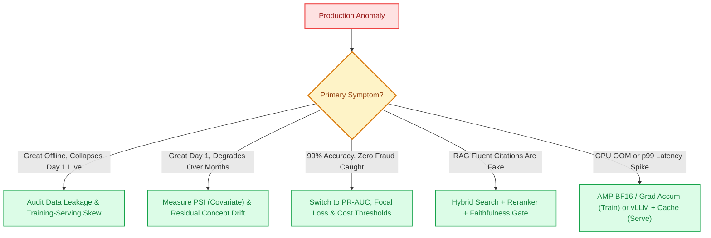

# Module 12: Real-World ML & GenAI System Troubleshooting Scenarios

> **Difficulty:** Advanced | **Estimated Study Time:** 6-8 Hours | **Prerequisites:** [Modules 01 through 11](./11_mlops_cloud_and_finops.md)  
> **Focus:** Production war-room triage, silent data leakage detection, training-serving skew, CUDA OOM resolution, catastrophic forgetting, and tail latency debugging

[← Previous: Module 11: MLOps, Cloud & FinOps](./11_mlops_cloud_and_finops.md) | [Roadmap Index](../../README.md) | [Next: Module 13: Hands-On Algorithms from Scratch →](./13_algorithms_from_scratch.md)

---

## 1. Overview

Production AI systems rarely fail with an explicit Python syntax crash. Instead, they fail **silently**: offline models show pristine validation scores but collapse on Day 1 of production; retrieval systems return fluent but hallucinated citations; and GPU clusters experience sudden tail-latency spikes under high concurrency. This module arms engineers with systematic war-room diagnostic decision trees across 9 critical failure scenarios:



---

## 2. Learning Objectives

By the end of this module, you will be able to:
- **Triage silent production failures** using structured diagnostic decision trees across classical ML, Deep Learning, and Generative AI systems.
- **Identify and eradicate subtle data leakage** (target leakage, look-ahead temporal leakage, preprocessor snooping).
- **Resolve CUDA Out-Of-Memory (OOM) exceptions** during training and inference using gradient accumulation, activation checkpointing, and mixed precision (`BF16`).
- **Diagnose and mitigate catastrophic forgetting** during foundation model fine-tuning using parameter-efficient adapters (LoRA) and replay regularization.
- **Debug tail latency spikes (p99)** in LLM serving clusters using prefix caching, speculative decoding, and continuous batching.

---

## 3. Prerequisites

- **Full Curriculum Mastery:** Foundations, Classical ML, Deep Learning, Generative AI, Agents, and MLOps from [Modules 01 through 11](./11_mlops_cloud_and_finops.md).

---

## 4. Core Concepts

### 4.1 The 3 Classes of Silent Machine Learning Failures
1. **Data Leakage & Skew:** The model had access to information during training that does not exist at inference time.
2. **Distribution Drift:** Real-world distributions change over time (Covariate Drift $P(X)$ or Concept Drift $P(Y \mid X)$).
3. **Metric Misalignment:** Optimizing a loss function that does not correlate with business utility (e.g. optimizing accuracy on $0.1\%$ fraud).

### 4.2 The War-Room Triage Protocol
When an incident is reported:
- **Step 1: Replicate in Isolation:** Can the anomaly be reproduced on a fixed sample dataset?
- **Step 2: Compare Input Features:** Calculate PSI on incoming features vs. training baseline.
- **Step 3: Verify Output Calibration:** Are predicted probabilities shifted or saturated at extremes ($0.0$ or $1.0$)?
- **Step 4: Rollback to Champion:** If metrics breach SLAs, activate immediate fallback to the previous checkpoint.

---

## 5. Technical Deep Dive: War-Room Scenarios

### Scenario 1: High Test Accuracy, Zero Fraud Detection
- **Symptom:** Fraud model achieves $99.8\%$ accuracy, but executive dashboard reports undetected fraud losses.
- **Root Cause:** Severe class imbalance ($0.2\%$ base rate). Predicting 0 for every sample yields $99.8\%$ accuracy with $0\%$ recall.
- **Remediation:** Switch optimization metric to PR-AUC. Tune the decision threshold using a business cost matrix ($C_{\text{FN}} = \$500, C_{\text{FP}} = \$25$).

### Scenario 2: Perfect Offline Validation, Collapses on Day 1
- **Symptom:** Validation AUC is $0.98$; Day 1 live inference AUC drops to $0.52$.
- **Root Cause:** Target leakage. A feature created *after* the target event (e.g. `refund_processed_timestamp` or `account_status_closed`) was included in training features.
- **Remediation:** Remove leaky columns. Enforce strict `TimeSeriesSplit` cross-validation and audit feature creation timestamps.

### Scenario 3: Training CUDA Out-of-Memory (OOM)
- **Symptom:** PyTorch raises `torch.cuda.OutOfMemoryError` on batch 12 of training.
- **Root Cause:** Large batch size and activation memory accumulation.
- **Remediation:**
  1. Reduce per-device batch size by $4\times$ and enable **Gradient Accumulation** (accumulate gradients over 4 steps before `optimizer.step()`).
  2. Enable automatic mixed precision: `torch.autocast("cuda", dtype=torch.bfloat16)`.
  3. Enable **Activation Checkpointing**: discard intermediate activations during forward pass and recompute them during backward pass.

### Scenario 4: RAG Hallucinated Answers with Confident Citations
- **Symptom:** LLM produces fluent answers citing document paragraphs, but the cited facts are non-existent or fabricated.
- **Root Cause:** Weak vector retrieval returning ungrounded chunks, combined with lack of temperature control and absence of an evaluation filter.
- **Remediation:**
  1. Switch dense-only retrieval to **Qdrant Hybrid Search** (Dense + BM25 via RRF).
  2. Set LLM `temperature = 0.0`.
  3. Deploy an automated output faithfulness guardrail that verifies every factual statement against the source context before responding.

### Scenario 5: Catastrophic Forgetting After Fine-Tuning
- **Symptom:** An LLM fine-tuned on internal SQL generation loses general instruction-following and reasoning abilities.
- **Root Cause:** Full parameter fine-tuning on a narrow dataset with high learning rate overwritten pre-trained representations.
- **Remediation:** Switch to **LoRA** (freezing the base model) and mix 10%–20% general instruction data into the fine-tuning corpus as a replay regularization anchor.

---

## 6. Hands-on Implementation

Implement an automated Data Leakage Diagnostic Scanner in Python that identifies suspicious correlations between features and targets:

```python
import numpy as np

def scan_for_target_leakage(
    X: np.ndarray, y: np.ndarray, feature_names: list[str], threshold: float = 0.95
) -> list[str]:
    leaky_features = []
    for i, name in enumerate(feature_names):
        col = X[:, i]
        # Skip constant columns
        if col.std() < 1e-8:
            continue
        corr = float(np.corrcoef(col, y)[0, 1])
        if abs(corr) >= threshold:
            leaky_features.append(f"{name} (Correlation: {corr:.3f})")
    return leaky_features

# Verification
rng = np.random.default_rng(42)
N = 1000
legit_feat1 = rng.normal(size=N)
legit_feat2 = rng.normal(size=N)
y = (legit_feat1 + legit_feat2 > 0).astype(int)

# Inadvertently leaked post-event column
leaky_col = y * 1.0 + rng.normal(scale=0.01, size=N)

X_data = np.column_stack([legit_feat1, legit_feat2, leaky_col])
names = ["user_age", "monthly_activity", "post_event_flag"]

flags = scan_for_target_leakage(X_data, y, names)
assert len(flags) == 1 and "post_event_flag" in flags[0]
print("Lab 12 Passed! Successfully identified target leakage feature:", flags)
```

---

## 7. Practical Exercises

### Exercise 1: Gradient Accumulation Implementation
1. Write a PyTorch training loop that simulates an effective batch size of $128$ using a physical batch size of $16$ and gradient accumulation over $8$ steps.
2. Verify that loss scaling and `optimizer.zero_grad()` are invoked only after the 8th step.

### Exercise 2: RAG Context Truncation Recovery
1. When retrieved context chunks exceed an LLM's maximum prompt budget, implement a priority ranker that preserves chunks with highest cross-encoder relevance scores.

---

## 8. Mini Project

### Production Incident Post-Mortem Generator
Build an automated triage incident reporter:
- **Input:** A JSON log of a failed model deployment containing training AUC, live inference AUC, PSI metrics, and memory usage.
- **Analysis:** Automatically diagnoses the root cause (e.g. Covariate Drift, Target Leakage, or Out-Of-Memory) based on diagnostic threshold rules.
- **Output:** Generates a structured markdown incident post-mortem with corrective actions.

---

## 9. Advanced Topics

- **Silent Floating-Point Underflow in Custom CUDA Kernels:** How subnormal numbers degrade half-precision FP16 operations without triggering explicit exceptions.
- **Deadlock in Distributed Multi-GPU Training:** Diagnosing desynchronized ranks during barrier synchronization in PyTorch DDP.
- **KV Cache Prefix Fragmentation under Asynchronous Streaming:** Managing dynamically growing sequence buffers in high-throughput inference engines.

---

## 10. Common Mistakes & Gotchas

1. **Debugging Live Traffic Without Seed Isolation:** Attempting to debug non-deterministic model responses without pinning random seeds and temperature to 0.0.
2. **Restarting Crashed Pods Without Preserving OOM Logs:** Allowing Kubernetes to restart crashed pods in a crash-loop without capturing memory snapshots.
3. **Changing Multiple Hyperparameters Simultaneously:** Modifying learning rate, batch size, and architecture at the same time during incident recovery, making it impossible to isolate the working fix.

---

## 11. Interview Questions & System Design

### Q1: How do you systematically debug a model that performs well offline but fails in production?
1. **Verify Feature Consistency:** Audit for training-serving skew by logging production inputs and comparing feature distribution statistics (mean, variance, PSI) against training distributions.
2. **Check for Target Leakage:** Verify that no input feature is derived from post-event data that would not be accessible at inference time.
3. **Inspect Time Splits:** Ensure offline evaluation utilized chronological time-series splits rather than random $K$-fold cross-validation.
4. **Audit Label Delay:** Account for delayed feedback loops (e.g. fraud taking 30–60 days to be formally reported by banks).

### Q2: How do you resolve a GPU Out-of-Memory (OOM) error during LLM fine-tuning without buying a bigger GPU?
1. **Switch to LoRA / QLoRA:** Freeze base model weights and train low-rank adapter matrices, quantizing the base model to 4-bit (NF4).
2. **Enable Gradient Checkpointing:** Trade compute for memory by discarding activations during forward pass and recomputing them during backward pass (reducing activation memory by ~60%).
3. **Reduce Batch Size & Use Gradient Accumulation:** Drop physical batch size to 1 or 2 and accumulate gradients across multiple forward steps.
4. **Use AdamW 8-bit:** Utilize quantized optimizer states via `bitsandbytes` to reduce Adam memory overhead.

---

## 12. Recommended Resources

- **Paper:** [Hidden Technical Debt in Machine Learning Systems](https://papers.nips.cc/paper_files/paper/2015/hash/86df7dcfd896fcaf2674f757a2463eba-Abstract.html) (Sculley et al., NeurIPS 2015).
- **Playbook:** [End-to-End Lifecycle Playbook](../../projects/end_to_end_lifecycle_playbook.md).
- **Guide:** [PyTorch Performance Tuning Guide](https://pytorch.org/tutorials/recipes/recipes/tuning_guide.html).

---

## 13. Completion Checklist

- [ ] Execute the war-room triage decision tree for common production ML failure modes.
- [ ] Implement and verify an automated target leakage detection scanner.
- [ ] Configure PyTorch gradient accumulation to bypass GPU memory bottlenecks.
- [ ] Implement Hybrid Search and faithfulness validation to eradicate RAG hallucinations.
- [ ] Describe the corrective steps for mitigating catastrophic forgetting in fine-tuned models.

---

[← Previous: Module 11: MLOps, Cloud & FinOps](./11_mlops_cloud_and_finops.md) | [Home](../../README.md) | [Next: Module 13: Hands-On Algorithms from Scratch →](./13_algorithms_from_scratch.md)
