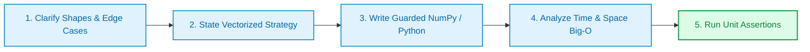

# Module 13: Hands-On Coding Challenges & ML Algorithms from Scratch

> **Difficulty:** Advanced | **Estimated Study Time:** 8-10 Hours | **Prerequisites:** [Modules 01 through 06](../../ROADMAP.md) | **Lab:** [Scratch Challenges Notebook](../../notebooks/machine-learning/02_ml_from_scratch_challenges.ipynb) | **[Open in Colab](https://colab.research.google.com/github/FirdowsRahaman/agentic-ai-and-ml-roadmap/blob/main/notebooks/machine-learning/02_ml_from_scratch_challenges.ipynb)**  
> **Focus:** First-principles NumPy implementations of numerically stable Softmax, batch gradient descent, K-Means clustering, $O(N)$ Top-K Cosine search, and Causal Attention

[← Previous: Module 12: Practical Troubleshooting Scenarios](./12_system_troubleshooting_scenarios.md) | [Roadmap Index](../../README.md) | [Explore Portfolio Projects →](../../projects/README.md)

---

## 1. Overview

Nothing cements deep technical comprehension or prepares you better for senior coding and machine learning systems screens than implementing foundational algorithms from first principles in **clean, vectorized, numerically stable Python** without relying on high-level framework wrappers (`scikit-learn` or `PyTorch`). This module guides you through the 5-step engineering protocol for translating mathematical equations into production-ready code:



---

## 2. Learning Objectives

By the end of this module, you will be able to:
- **Implement numerically stable operations** (Softmax, Log-Sum-Exp, Sigmoid clipping) preventing floating-point overflow and underflow (`NaN` errors).
- **Formulate vectorized gradient descent** for linear and logistic regression in pure NumPy with explicit shape assertions.
- **Calculate complete classification evaluation matrices** (Confusion Matrix, Precision, Recall, F1 Score) without third-party libraries.
- **Implement K-Means clustering** using broadcasting to compute pairwise Euclidean distances efficiently.
- **Design fast $O(N)$ vector retrieval** using `np.argpartition` instead of slow $O(N \log N)$ sorting.
- **Construct Causal Multi-Head Self-Attention** from scratch in pure NumPy.

---

## 3. Prerequisites

- **Vectorized Computing:** Array broadcasting, matrix multiplication, and stride mechanics from [Module 01](../01-foundations/01_python_sql_and_data_stack.md).
- **Mathematical Foundations:** Dot products, norms, gradients, and cross-entropy loss from [Module 02](../01-foundations/02_math_and_statistics.md).

---

## 4. Core Concepts: The 5-Step Algorithm Protocol

When implementing machine learning primitives from scratch:
1. **Clarify Shapes & Types:** Specify exact tensor input/output shapes (e.g. $X \in \mathbb{R}^{N \times D}$, $\mathbf{y} \in \mathbb{R}^N$).
2. **Prevent Numerical Instability:** Protect against division by zero (add $\epsilon = 10^{-12}$) and exponential overflow (subtract $\max(z)$).
3. **Vectorize Fully:** Avoid raw Python loops over samples; use NumPy multi-axis broadcasting and matrix products.
4. **Analyze Complexity:** State exact Time and Memory Big-$O$ complexity.
5. **Verify with Assertions:** Write reproducible unit tests validating boundary cases.

---

## 5. Technical Deep Dive: The Core Implementations

### 5.1 Numerically Stable Softmax & Cross-Entropy Loss
Naively computing $e^{z_i}$ when $z_i = 1000$ triggers `FloatingPointError: overflow`. Subtracting the row-wise maximum $\max_j(z_j)$ leaves the mathematical probability identical while bounding all exponentials to $\le 1.0$:

$$\text{Softmax}(\mathbf{z})_i = \frac{e^{z_i - \max(\mathbf{z})}}{\sum_j e^{z_j - \max(\mathbf{z})}}$$

```python
import numpy as np

def stable_softmax(logits: np.ndarray) -> np.ndarray:
    """Computes row-wise numerically stable softmax over 2D logits (N, C)."""
    assert logits.ndim == 2, f"Expected 2D array, got {logits.shape}"
    shifted = logits - np.max(logits, axis=-1, keepdims=True)
    exps = np.exp(shifted)
    return exps / np.sum(exps, axis=-1, keepdims=True)

def categorical_cross_entropy(y_true: np.ndarray, y_probs: np.ndarray, eps: float = 1e-12) -> float:
    """Computes cross-entropy loss from one-hot y_true and probabilities y_probs."""
    probs_clipped = np.clip(y_probs, eps, 1.0 - eps)
    return -float(np.mean(np.sum(y_true * np.log(probs_clipped), axis=-1)))
```

### 5.2 Vectorized Batch Gradient Descent (Linear Regression)
Fitting $\hat{\mathbf{y}} = X \mathbf{w} + b$ by minimizing MSE $\mathcal{L} = \frac{1}{N} \|X\mathbf{w} + b - \mathbf{y}\|_2^2$:
- Gradient w.r.t weights: $\frac{\partial \mathcal{L}}{\partial \mathbf{w}} = \frac{2}{N} X^T (X\mathbf{w} + b - \mathbf{y})$
- Gradient w.r.t bias: $\frac{\partial \mathcal{L}}{\partial b} = \frac{2}{N} \sum (X\mathbf{w} + b - \mathbf{y})$

```python
def linear_regression_fit(
    X: np.ndarray, y: np.ndarray, lr: float = 0.05, epochs: int = 500
) -> tuple[np.ndarray, float]:
    n_samples, n_features = X.shape
    w = np.zeros(n_features, dtype=float)
    b = 0.0

    for _ in range(epochs):
        preds = X @ w + b
        error = preds - y
        dw = (2.0 / n_samples) * (X.T @ error)
        db = (2.0 / n_samples) * float(np.sum(error))
        w -= lr * dw
        b -= lr * db

    return w, b
```

### 5.3 Efficient Top-K Cosine Search via `np.argpartition`
Sorting an entire corpus of $N$ documents takes $O(N \log N)$ time. In vector search, we only need the top $K$ items. Using `np.argpartition` finds the top $K$ items in linear $O(N)$ time:

```python
def top_k_cosine_search(query: np.ndarray, corpus: np.ndarray, k: int = 3) -> tuple[np.ndarray, np.ndarray]:
    """Retrieves top-k cosine similarity indices in O(N) using np.argpartition."""
    # Normalize query and corpus to unit length
    q_norm = query / max(float(np.linalg.norm(query)), 1e-12)
    c_norm = corpus / np.maximum(np.linalg.norm(corpus, axis=1, keepdims=True), 1e-12)

    sims = c_norm @ q_norm
    n = len(corpus)
    k = min(k, n)

    # Linear time partition to find k largest elements
    partition_idx = np.argpartition(sims, -k)[-k:]
    sorted_top_k = partition_idx[np.argsort(-sims[partition_idx])]
    return sorted_top_k, sims[sorted_top_k]
```

---

## 6. Hands-on Implementation

Verify the complete suite of algorithms against deterministic ground-truth checks:

```python
# 1. Softmax probability sum
logits = np.array([[1000.0, 1001.0, 1002.0], [-10.0, 0.0, 10.0]])
probs = stable_softmax(logits)
assert np.allclose(probs.sum(axis=-1), 1.0)
assert not np.isnan(probs).any()

# 2. Linear Regression Recovery
X_test = np.array([[1.0, 2.0], [2.0, 3.0], [3.0, 4.0], [4.0, 5.0]])
y_test = 2.0 * X_test[:, 0] + 3.0 * X_test[:, 1] + 1.0
w_fit, b_fit = linear_regression_fit(X_test, y_test, lr=0.02, epochs=2000)
assert np.isclose(b_fit, 1.0, atol=0.1)

# 3. Top-K Cosine Retrieval
corpus = np.array([[1.0, 0.0], [0.0, 1.0], [0.9, 0.1], [-1.0, 0.0]])
query = np.array([1.0, 0.0])
indices, scores = top_k_cosine_search(query, corpus, k=2)
assert list(indices) == [0, 2]
print("Lab 13 Passed! All first-principles algorithms verified.")
```

---

## 7. Practical Exercises

### Exercise 1: Vectorized K-Means Clustering
1. Implement a complete `KMeans` class in pure NumPy with `fit(X, k=3, max_iter=100)`.
2. Compute pairwise Euclidean distances using broadcasting: $\|X - C\|^2 = \|X\|^2 - 2XC^T + \|C\|^2$.
3. Verify cluster convergence on synthetic 2D Gaussian blobs.

### Exercise 2: Binary F1 Score from Raw Logits
1. Write a function `compute_f1_score(y_true, logits, threshold=0.0)` that computes the Confusion Matrix (TP, FP, FN, TN) and outputs Precision, Recall, and F1 score without scikit-learn.

---

## 8. Mini Project

### Pure NumPy Transformer Forward Pass
Construct a self-contained Decoder-Only Attention Block in pure NumPy:
- **Components:**
  1. Multi-Head Causal Attention with upper-triangular masking.
  2. Residual skip connections: $x + \text{Attention}(\text{LayerNorm}(x))$.
  3. SwiGLU / GeLU feed-forward projection: $x + \text{FFN}(\text{LayerNorm}(x))$.
- **Companion Lab:** Complete the interactive notebook at [`notebooks/deep-learning/03_mini_transformer_attention.ipynb`](../../notebooks/deep-learning/03_mini_transformer_attention.ipynb).

---

## 9. Advanced Topics

- **Strided Array Tricks (`np.lib.stride_tricks.as_strided`):** Creating sliding 2D convolution windows over tensors without copying memory.
- **LogSumExp Trick in Cross-Entropy:** Computing $\log \sum e^{z_i} = c + \log \sum e^{z_i - c}$ to evaluate cross-entropy loss in a single numerically stable pass without separate softmax intermediate buffers.
- **Bilinear Forms & Mahalanobis Distance:** Measuring distances accounting for covariance correlations: $D_M(\mathbf{x}, \mathbf{y}) = \sqrt{(\mathbf{x} - \mathbf{y})^T \Sigma^{-1} (\mathbf{x} - \mathbf{y})}$.

---

## 10. Common Mistakes & Gotchas

1. **Unstable Exponentials in Softmax:** Computing `np.exp(z)` directly without subtracting $\max(z)$, causing catastrophic `Inf / Inf = NaN` crashes on large logits.
2. **Sorting the Entire Array for Top-K:** Calling `np.argsort(scores)[::-1][:k]` ($O(N \log N)$) instead of `np.argpartition` ($O(N)$) when querying million-vector indexes.
3. **Broadcasting Shape Mismatches:** Forgetting `keepdims=True` in reduction operations (`mean(axis=1, keepdims=True)`), leading to silent incorrect broadcasting across sample rows.

---

## 11. Interview Questions & System Design

### Q1: Why is `np.argpartition` preferred over `np.argsort` for Top-K nearest neighbor search?
`np.argsort` executes a full quicksort or mergesort over all $N$ elements, requiring $O(N \log N)$ comparisons. `np.argpartition` uses the Introselect algorithm (a combination of Quickselect and Median-of-Medians) to find the $K$ smallest/largest elements in $O(N)$ expected linear time without sorting the remaining $N - K$ elements, yielding massive performance gains when $N \gg K$ (e.g. retrieving Top-10 from $1,000,000$ documents).

### Q2: How do you prevent numerical underflow when computing Cross-Entropy Loss?
In cross-entropy loss $\mathcal{L} = -\sum y_i \log(p_i)$, if a predicted probability $p_i$ reaches exactly $0.0$, $\log(0.0)$ produces $-\infty$ (and subsequent gradient updates produce `NaN`). Numerical underflow is prevented by clipping predicted probabilities to a small non-zero epsilon: `np.clip(p, 1e-12, 1.0 - 1e-12)`.

---

## 12. Recommended Resources

- **Interactive Lab:** [Scratch Challenges Notebook](../../notebooks/machine-learning/02_ml_from_scratch_challenges.ipynb).
- **Textbook:** [Mathematics for Machine Learning](https://mml-book.github.io/) (Deisenroth et al.).
- **Visual Series:** [StatQuest: Machine Learning Fundamentals](https://statquest.org/).

---

## 13. Completion Checklist

- [ ] Implement numerically stable Softmax and Cross-Entropy loss in pure NumPy.
- [ ] Implement multivariate batch gradient descent for linear regression from scratch.
- [ ] Implement an $O(N)$ Top-K Cosine search function using `np.argpartition`.
- [ ] Build a pure NumPy K-Means clustering algorithm with vectorized Euclidean distances.
- [ ] Pass all unit assertions in [`notebooks/machine-learning/02_ml_from_scratch_challenges.ipynb`](../../notebooks/machine-learning/02_ml_from_scratch_challenges.ipynb).

---

[← Previous: Module 12: Practical Troubleshooting Scenarios](./12_system_troubleshooting_scenarios.md) | [Home](../../README.md) | [Explore Portfolio Projects →](../../projects/README.md)
