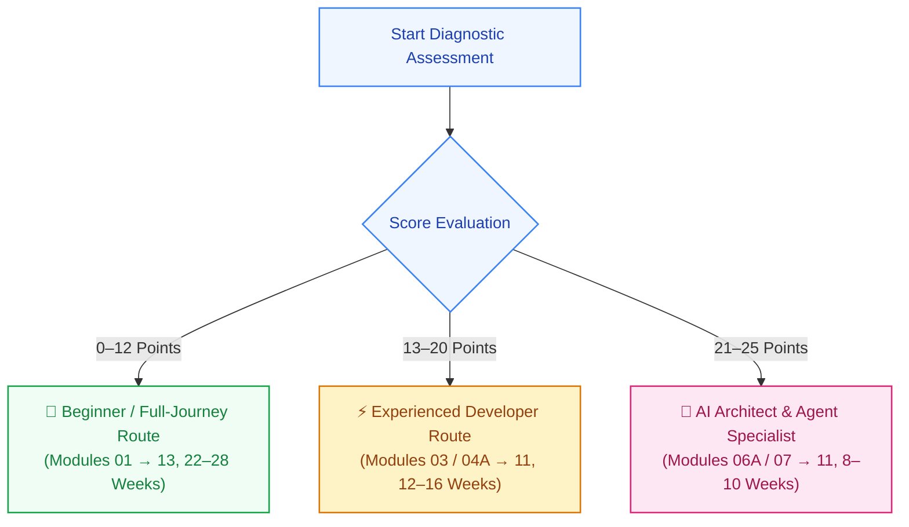

# Diagnostic Assessment Guide: Choose Your Entry Route

[← Back to Documentation](./index.md) | [Learning Paths](./learning-paths.md) | [Roadmap](../ROADMAP.md)

---

## 1. Overview & Assessment Purpose

The **Agentic AI & ML Engineering Roadmap** is engineered to serve both software engineers transitioning into AI and aspiring machine learning practitioners. To ensure you invest your time effectively, take this diagnostic assessment before starting the curriculum.

### Two Standard Entry Routes

---

## 2. Six Diagnostic Knowledge Checks

Award yourself **1 point** for each checkbox you can confidently demonstrate without consulting search engines or AI assistants.

### Section A: Python & Software Engineering (Max: 5 Points)
- [ ] **A1:** Can write idiomatic Python generator functions using `yield` and explain memory differences versus list comprehensions.
- [ ] **A2:** Can implement a custom context manager using the `__enter__` and `__exit__` dunder protocol or `contextlib.contextmanager`.
- [ ] **A3:** Understand Python 3.12+ type hints (`typing.Protocol`, `TypeVar`, `dataclasses.dataclass(slots=True)`).
- [ ] **A4:** Can configure non-root Docker containers, write unit tests in `pytest`, and manage dependencies with `pyproject.toml`.
- [ ] **A5:** Understand asynchronous I/O (`asyncio.gather`, `asyncio.Semaphore`, async task cancellation, event loop mechanics).

### Section B: SQL & Data Engineering (Max: 4 Points)
- [ ] **B1:** Can write SQL Window Functions (`ROW_NUMBER()`, `RANK()`, `LAG()`, `LEAD()`) using `PARTITION BY` and `ORDER BY`.
- [ ] **B2:** Understand Common Table Expressions (CTEs) and can optimize complex analytical queries with appropriate indexes.
- [ ] **B3:** Understand the trade-offs between row-oriented (CSV, JSON, PostgreSQL) and columnar storage (Parquet, Arrow, DuckDB).
- [ ] **B4:** Can implement leak-free temporal data splits for machine learning training sets.

### Section C: Linear Algebra & Matrix Calculus (Max: 4 Points)
- [ ] **C1:** Can calculate matrix products, dot products, and vector norms ($L_1, L_2$) manually and in NumPy without loops.
- [ ] **C2:** Understand Singular Value Decomposition (SVD), Eigenvalues, and how Principal Component Analysis (PCA) projects variance.
- [ ] **C3:** Can compute partial derivatives and apply the multivariate Chain Rule to backpropagate loss through computational graphs.
- [ ] **C4:** Understand the Jacobian matrix and why vector-Jacobian products (VJPs) power modern autograd engines (PyTorch).

### Section D: Probability & Statistical Inference (Max: 4 Points)
- [ ] **D1:** Understand Bayes' Theorem and can calculate posterior probability under severe class imbalance (the base-rate fallacy).
- [ ] **D2:** Understand the Central Limit Theorem (CLT) and when sample means can be approximated by normal distributions.
- [ ] **D3:** Can formulate null hypotheses, compute two-tailed $p$-values, and conduct conversion A/B tests with sample power calculations.
- [ ] **D4:** Understand heavy-tailed distributions and why P99 latency percentiles are critical for service level objectives (SLOs).

### Section E: Classical Machine Learning & Deep Learning (Max: 4 Points)
- [ ] **E1:** Understand the bias-variance trade-off and can diagnose overfitting vs. underfitting using train/validation loss curves.
- [ ] **E2:** Can implement a complete `scikit-learn` Pipeline with categorical encoding and scaling that avoids train-test data leakage.
- [ ] **E3:** Can evaluate imbalanced classifiers using PR-AUC (Precision-Recall) and Cost Matrices rather than misleading accuracy metrics.
- [ ] **E4:** Can build a custom PyTorch training loop with forward pass, loss computation, `optimizer.zero_grad()`, `loss.backward()`, and `optimizer.step()`.

### Section F: APIs, LLMs & Systems Engineering (Max: 4 Points)
- [ ] **E5:** Can build production REST APIs in FastAPI with strict Pydantic v2 request/response validation schemas.
- [ ] **E6:** Understand Scaled Dot-Product Attention math ($Q, K, V$), multi-head projections, and causal autoregressive masks.
- [ ] **E7:** Understand Hybrid Search (combining dense embeddings and sparse BM25) and Reciprocal Rank Fusion (RRF).
- [ ] **E8:** Can explain the ReAct agent loop (Thought, Action, Observation) and how AST security filters prevent remote code execution.

---

## 3. Recommended Curriculum Starting Points

| Total Score | Diagnostic Evaluation | Recommended Starting Unit | Estimated Duration |
|---|---|---|---|
| **0 – 12 Points** | **Foundations Required** | **[Module 01: Python, SQL & Data Stack](../curriculum/01-foundations/01_python_sql_and_data_stack.md)** | 22–28 Weeks |
| **13 – 16 Points** | **Strong Software Baseline** | **[Module 03: Classical ML & RecSys](../curriculum/02-core-ml-and-dl/03_classical_ml_and_recsys.md)** | 16–20 Weeks |
| **17 – 20 Points** | **Intermediate ML Engineer** | **[Module 04A: Core Deep Learning & PyTorch](../curriculum/02-core-ml-and-dl/04a_deep_learning_and_pytorch.md)** | 12–16 Weeks |
| **21 – 25 Points** | **Senior Engineer / Architect** | **[Module 06A: LLM Architecture & Inference](../curriculum/03-modern-ai-and-genai/06a_llm_architecture_and_inference.md)** | 8–12 Weeks |

> [!TIP]
> **Refresher Modules:** Even experienced developers are encouraged to review the code implementations in [Module 02: Math & Statistics](../curriculum/01-foundations/02_math_and_statistics.md) and [Module 13A: ML Algorithms from Scratch](../curriculum/05-production-and-practice/13_algorithms_and_patterns_from_scratch/13a_ml_algorithms.md) to solidify mathematical fundamentals.
