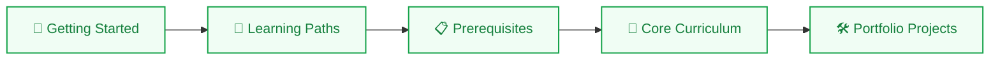

# Agentic AI & ML Engineering Documentation

Welcome to the **Agentic AI & ML Roadmap** documentation portal. This platform is designed to take developers, data scientists, and software engineers from mathematical and algorithmic foundations to production-grade, distributed Agentic AI systems.

---

## Quick Navigation

- **[Getting Started](./getting-started.md):** Set up your local environment, install dependencies, and run your first lab.
- **[Learning Paths](./learning-paths.md):** Choose a persona-specific path (Foundations, Applied ML, or Agent Engineer).
- **[Prerequisites Guide](./prerequisites.md):** Assess your background and bridge knowledge gaps.
- **[Curriculum Index](../ROADMAP.md):** Explore all 13 modules across the 6 engineering tiers.
- **[Technical Glossary](./glossary.md):** Precise definitions of production AI, MLOps, and agentic terminology.
- **[FAQ](./faq.md):** Answers to common architectural and learning questions.

---

## Core Philosophy
1. **Zero-Fluff, Production-First:** Every concept is paired with production code, mathematical proofs, or system failure triage trees.
2. **Local $0 Barrier:** Core foundations, hybrid RAG, local models (Ollama), and MLOps are runnable on consumer laptops without cloud bills.
3. **Defense-in-Depth:** Robust software engineering (type hints, test suites, non-root containers, AST evaluators, and PSI drift monitors) is taught as a first-class citizen.
