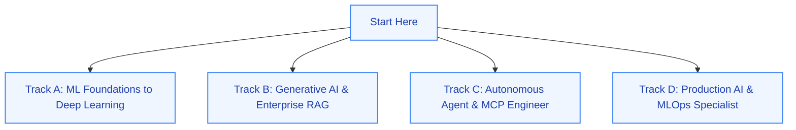

# Tailored Learning Paths

[← Back to Documentation](./index.md) | [Prerequisites](./prerequisites.md) | [Roadmap](../ROADMAP.md)

---

## Choose Your Track

Depending on your background and target career objectives, you do not need to follow a strictly linear path. Choose the path that matches your current goal:

---

### Track A: Machine Learning & Deep Learning Foundations
*Target Roles: Applied Machine Learning Engineer, Data Scientist*

1. **[Module 01: Python, SQL & Modern Data Stack](../curriculum/01-foundations/01_python_sql_and_data_stack.md)** — Vectorized computing & SQLite window functions.
2. **[Module 02: Math & Statistics for AI Engineers](../curriculum/01-foundations/02_math_and_statistics.md)** — Linear algebra, matrix projections, and hypothesis testing.
3. **[Module 03: Classical ML & RecSys](../curriculum/02-machine-learning/03_classical_ml_and_recsys.md)** — Leak-free preprocessing pipelines & Two-Tower retrieval.
4. **[Module 04: Deep Learning & PyTorch Loops](../curriculum/03-deep-learning/04_deep_learning_and_rl.md)** — Computational graphs, autograd backpropagation, and custom training loops.
5. **[Module 13: Algorithms from Scratch](../curriculum/06-production-ai/13_algorithms_from_scratch.md)** — Pure NumPy implementations of Softmax, Top-K Cosine, and Attention.
- **Capstone Project:** [Two-Stage RecSys Engine](../projects/advanced/README.md).

---

### Track B: Generative AI & Enterprise RAG
*Target Roles: Generative AI Engineer, LLM Application Engineer*

1. **[Module 05: NLP, CV & Multimodal AI](../curriculum/04-generative-ai/05_nlp_cv_and_multimodal.md)** — Tokenizers, Transformers, ViT, and CLIP.
2. **[Module 06: LLMs, Fine-Tuning & RAG](../curriculum/04-generative-ai/06_llms_finetuning_and_rag.md)** — LoRA parameter math, Qdrant Hybrid RRF, and vLLM serving.
3. **[Starter Project: Air-Gapped Hybrid RAG](../projects/intermediate/starter-local-rag-agent/README.md)** — In-memory BM25 + Dense Cosine vector fusion with DuckDB SQL.
4. **[Module 10: Agent Evals, Safety & FinOps](../curriculum/05-agentic-ai/10_agent_evals_and_safety.md)** — Golden eval datasets, indirect prompt injection defense, and token optimization.
- **Capstone Project:** [High-Throughput vLLM Serving & Semantic Cache](../projects/advanced/README.md).

---

### Track C: Autonomous Agent & MCP Engineer
*Target Roles: AI Agent Engineer, Multi-Agent Systems Architect*

1. **[Module 07: AI Agents Fundamentals](../curriculum/05-agentic-ai/07_ai_agents_fundamentals.md)** — Workflows vs. Agents, ReAct reasoning loops, and AST security sandboxes.
2. **[Module 08: Tools, LangGraph & Google ADK](../curriculum/05-agentic-ai/08_tools_langgraph_and_adk.md)** — Cyclical state machine graphs, checkpointing, and HITL interrupts.
3. **[Module 09: Multi-Agent Systems & MCP](../curriculum/05-agentic-ai/09_multi_agent_and_mcp.md)** — Supervisor-worker topologies, context isolation, and FastMCP tool servers.
4. **[Module 10: Agent Evals & Safety](../curriculum/05-agentic-ai/10_agent_evals_and_safety.md)** — Trajectory testing and pre-execution validation filters.
- **Capstone Project:** [Autonomous Operations Copilot with Google ADK & MCP](../projects/advanced/README.md).

---

### Track D: Production AI, MLOps & Platform Engineer
*Target Roles: MLOps Engineer, AI Platform Engineer*

1. **[Module 11: Production MLOps, Drift & Cloud FinOps](../curriculum/06-production-ai/11_mlops_cloud_and_finops.md)** — Zero-pickle serialization, FastAPI, Docker, and PSI drift monitoring.
2. **[Starter Project: Local MLOps API](../projects/intermediate/starter-local-mlops/README.md)** — End-to-end training and inference service with automated PSI retraining alerts.
3. **[Module 12: System Troubleshooting Scenarios](../curriculum/06-production-ai/12_system_troubleshooting_scenarios.md)** — Triage trees for training-serving skew, memory leaks, and silent degradation.
4. **[End-to-End Lifecycle Playbook](../projects/end_to_end_lifecycle_playbook.md)** — Architecture, testing, and deployment standard operating procedures.
- **Capstone Project:** [Real-Time Fraud Prevention with Feast Feature Store](../projects/advanced/README.md).
