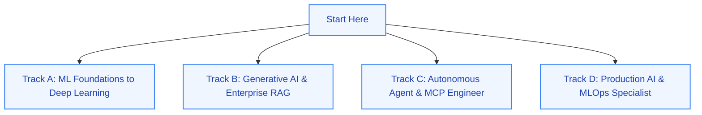

# Tailored Learning Paths

[← Back to Documentation](./index.md) | [Prerequisites](./prerequisites.md) | [Roadmap](../ROADMAP.md)

---

## Choose Your Track

Depending on your background and target career objectives, you do not need to follow a strictly linear path. Choose the path that matches your current goal:

---

### Track A: Machine Learning & Deep Learning Foundations
*Target Roles: Applied Machine Learning Engineer, Data Scientist*

1. **[Module 01: Python, SQL & Modern Data Stack](../curriculum/01-foundations/01_python_sql_and_data_stack.md)** — Vectorized computing & SQLite window functions.
2. **[Module 02: Math & Statistics for AI Engineers](../curriculum/01-foundations/02_math_and_statistics.md)** — Linear algebra, matrix projections, and hypothesis testing.
3. **[Module 03: Classical ML & RecSys](../curriculum/02-core-ml-and-dl/03_classical_ml_and_recsys.md)** — Leak-free preprocessing pipelines & Two-Tower retrieval.
4. **[Module 04A: Core Deep Learning & PyTorch Loops](../curriculum/02-core-ml-and-dl/04a_deep_learning_and_pytorch.md)** — Computational graphs, autograd backpropagation, and custom training loops.
5. **[Module 13A: ML Algorithms from Scratch](../curriculum/05-production-and-practice/13_algorithms_and_patterns_from_scratch/13a_ml_algorithms.md)** — Pure NumPy implementations of Softmax, Top-K Cosine, and Attention.
- **Capstone Project:** [Two-Stage RecSys Engine](../projects/advanced/README.md).

---

### Track B: Generative AI & Enterprise RAG
*Target Roles: Generative AI Engineer, LLM Application Engineer*

1. **[Module 05A: NLP & Language Models](../curriculum/03-modern-ai-and-genai/05a_nlp_and_language_models.md)** — Tokenizers, BPE, embeddings, and BM25.
2. **[Module 06A: LLM Architecture & Inference](../curriculum/03-modern-ai-and-genai/06a_llm_architecture_and_inference.md)** — RoPE embeddings, KV cache scaling, and constrained JSON decoding.
3. **[Module 06B: RAG Engineering](../curriculum/03-modern-ai-and-genai/06b_rag_engineering.md)** — Qdrant Hybrid RRF, Cross-Encoder reranking, and retrieval evaluation.
4. **[Module 06C: Fine-Tuning & Serving](../curriculum/03-modern-ai-and-genai/06c_finetuning_and_serving.md)** — LoRA parameter math, vLLM continuous batching, and TTFT/TPOT latency.
5. **[Starter Project: Air-Gapped Hybrid RAG](../projects/intermediate/starter-local-rag-agent/README.md)** — In-memory BM25 + Dense Cosine vector fusion with DuckDB SQL.
6. **[Module 10: Agent Evals, Safety & FinOps](../curriculum/04-agentic-ai/10_agent_evaluation_and_safety.md)** — Golden eval datasets, indirect prompt injection defense, and token optimization.
- **Capstone Project:** [High-Throughput vLLM Serving & Semantic Cache](../projects/advanced/README.md).

---

### Track C: Autonomous Agent & MCP Engineer
*Target Roles: AI Agent Engineer, Multi-Agent Systems Architect*

1. **[Module 07: AI Agents Fundamentals](../curriculum/04-agentic-ai/07_agent_fundamentals.md)** — Workflows vs. Agents, ReAct reasoning loops, and AST security sandboxes.
2. **[Module 08: Tools, LangGraph & Google ADK](../curriculum/04-agentic-ai/08_agent_orchestration.md)** — Cyclical state machine graphs, checkpointing, and HITL interrupts.
3. **[Module 09: Multi-Agent Systems & MCP](../curriculum/04-agentic-ai/09_multi_agent_mcp_a2a.md)** — Supervisor-worker topologies, context isolation, and FastMCP tool servers.
4. **[Module 10: Agent Evals & Safety](../curriculum/04-agentic-ai/10_agent_evaluation_and_safety.md)** — Trajectory testing and pre-execution validation filters.
- **Capstone Project:** [Autonomous Operations Copilot with Google ADK & MCP](../projects/advanced/README.md).

---

### Track D: Production AI, MLOps & Platform Engineer
*Target Roles: MLOps Engineer, AI Platform Engineer*

1. **[Module 11: Production MLOps, Drift & Cloud FinOps](../curriculum/05-production-and-practice/11_production_ai_engineering.md)** — Zero-pickle serialization, FastAPI, Docker, and PSI drift monitoring.
2. **[Starter Project: Local MLOps API](../projects/intermediate/starter-local-mlops/README.md)** — End-to-end training and inference service with automated PSI retraining alerts.
3. **[Module 12: Incident Troubleshooting Labs](../curriculum/05-production-and-practice/12_incident_and_troubleshooting_labs.md)** — Triage trees for training-serving skew, memory leaks, and silent degradation.
4. **[Module 13B: AI Systems Patterns from Scratch](../curriculum/05-production-and-practice/13_algorithms_and_patterns_from_scratch/13b_system_patterns.md)** — Token bucket rate limiter, exponential backoff with full jitter, and circuit breakers.
5. **[End-to-End Lifecycle Playbook](../projects/end_to_end_lifecycle_playbook.md)** — Architecture, testing, and deployment standard operating procedures.
- **Capstone Project:** [Real-Time Fraud Prevention with Feast Feature Store](../projects/advanced/README.md).
