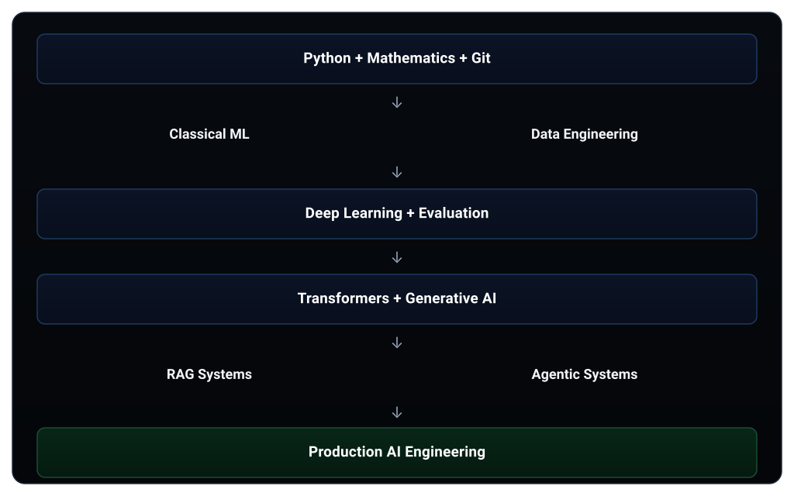
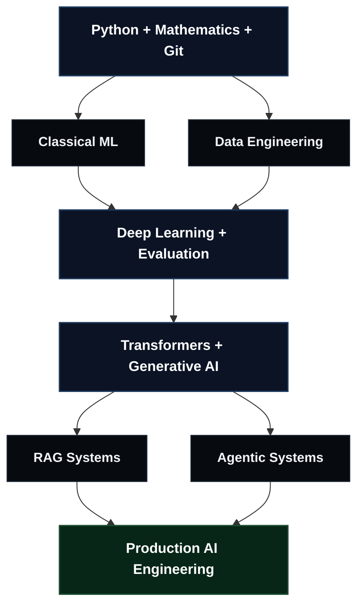

# Prerequisites & Self-Assessment

[← Back to Documentation](./index.md) | [Getting Started](./getting-started.md) | [Roadmap](../ROADMAP.md)

---

## 1. Self-Assessment Checklist

Before starting the curriculum, review your baseline proficiency. If you lack experience in a specific area, refer to the recommended prerequisite resources below.

### Software Engineering Baseline
- [ ] Comfortable writing modular Python functions, type hints, and exception handling.
- [ ] Familiarity with Git basics: `git clone`, `branch`, `commit`, and `pull request`.
- [ ] Basic SQL querying: `SELECT`, `WHERE`, `GROUP BY`, and `JOIN`.
- [ ] Understanding of virtual environments (`venv`, `conda`) and package managers (`pip`).

### Mathematical & Analytical Baseline
- [ ] Linear Algebra: Matrix multiplication, transpose, dot products, vector norms.
- [ ] Calculus: Derivatives, partial derivatives, and the chain rule of differentiation.
- [ ] Probability: Mean, variance, standard deviation, conditional probability $P(A|B)$, and Bayes' Theorem.

---

## 2. Prerequisite Bridging Resources

If you need a refresher before diving into Module 01, we recommend these focused, high-signal materials:

| Domain | Recommended Resource | Time Investment |
|---|---|---|
| **Python Fundamentals** | [Python Official Tutorial](https://docs.python.org/3/tutorial/) | 4–6 Hours |
| **Linear Algebra** | [3Blue1Brown: Essence of Linear Algebra](https://www.3blue1brown.com/topics/linear-algebra) | 3 Hours |
| **Calculus & Backprop** | [Andrej Karpathy: Building Micrograd](https://karpathy.ai/zero-to-hero.html) | 2.5 Hours |
| **Modern SQL** | [Mode SQL Tutorial](https://mode.com/sql-tutorial/) | 3 Hours |

---

## 3. Prerequisite Dependency Graph

The following conceptual dependency map illustrates how foundational engineering and mathematical primitives build toward production-grade systems:

  

 

---

## 4. Prerequisite Mapping by Tier

- **Tier 1 (Foundations):** Requires only high-school math and basic Python scripting.
- **Tier 2 (Classical ML):** Builds upon Tier 1 NumPy broadcasting and hypothesis testing.
- **Tier 3 (Deep Learning):** Requires vector calculus (chain rule) and matrix tensor operations.
- **Tier 4 (Generative AI):** Requires understanding of attention mechanisms and high-dimensional vector spaces.
- **Tier 5 (Autonomous Agents):** Requires stateful software architecture, asynchronous programming, and JSON schemas.
- **Tier 6 (Production AI):** Requires Docker containerization, REST API fundamentals (HTTP methods, status codes), and Linux command-line literacy.
