# ML & GenAI System Design Interview Framework

[← Back to Roadmap](../README.md) | [Classical ML Kit →](../machine-learning/classical_ml_questions.md) | [GenAI & Agents Kit →](../generative-ai/genai_and_agents_questions.md)

---

## The 7-Step 45-Minute System Design Blueprint

Never jump straight to *"Let's use XGBoost"* or *"Let's use LangGraph"* in minute 1. Drive the conversation systematically across these 7 stages:

```mermaid
flowchart LR
    S1["1. Clarify & Business KPI (5m)"] --> S2["2. ML Framing & Metrics (5m)"]
    S2 --> S3["3. Data & Point-in-Time Labels (8m)"]
    S3 --> S4["4. Features / Retrieval Pipeline (8m)"]
    S4 --> S5["5. Baseline -> SOTA Architecture (8m)"]
    S5 --> S6["6. Serving, Latency & Scale (6m)"]
    S6 --> S7["7. Drift, Guardrails & A/B (5m)"]

    classDef p1 fill:#E0F2FE,stroke:#0284C7,stroke-width:1.5px,color:#0369A1;
    classDef p2 fill:#EDE9FE,stroke:#7C3AED,stroke-width:1.5px,color:#4C1D95;
    classDef p3 fill:#DCFCE7,stroke:#16A34A,stroke-width:2px,color:#15803D;

    class S1,S2,S3 p1;
    class S4,S5 p2;
    class S6,S7 p3;
```

### Back-of-the-Envelope Capacity Cheatsheet
- **Traffic (`QPS`):** `10M requests/day` $\approx \frac{10^7}{86,400} \approx \mathbf{115\text{ avg QPS}}$ ($\approx \mathbf{350\text{ peak QPS}}$ at 3× peak).
- **Vector Index RAM (`HNSW`):** `1M chunks × 768 dims × 4 bytes (FP32) × 1.5 graph overhead` $\approx \mathbf{4.6\text{ GB RAM}}$ (or `~1.2 GB` with `INT8` scalar quantization).
- **LLM GPU Sizing:** `8B model @ FP16` $\approx 16\text{ GB}$ weights + `KV Cache` -> fits comfortably on 1× `L4` (24 GB) or `A10G` via `vLLM`.

---

## Worked Blueprint 1: Real-Time Payment Fraud Detection (`<50ms` p99 SLA)

1. **Clarify & Business KPI:** Minimize net chargeback dollar loss while keeping false-decline customer friction `< 0.5%`. Latency budget: **`<50ms` p99 synchronous**.
2. **ML Formulation:** Cost-sensitive binary classification outputting calibrated $P(\text{fraud} \mid \mathbf{x})$. Offline metric: **PR-AUC** and **Recall @ FPR = 0.5%** (never raw Accuracy on `0.1%` fraud!).
3. **Labels & Leakage Handling:** Chargebacks arrive 30-60 days late (**delayed feedback**). Use chronological splits + point-in-time feature joins (`merge_asof` / `Feast` offline store) so post-dispute signals never leak.
4. **Feature Tiers (`Feast`):**
   - *Static (`Snowflake`/Offline):* Account age, historical merchant chargeback rate.
   - *Streaming (`Kinesis -> Redis` Online Store, `<5ms`):* 5-min card velocity, distance from last IP/geolocation.
5. **Model Progression:** Logistic Regression baseline -> **`LightGBM` / `XGBoost`** trained with sample weights proportional to transaction dollar value.
6. **Serving Budget (`38ms` total):** API Gateway (`4ms`) + Redis `Feast` lookup (`5ms`) + `ONNX Runtime` tree scoring (`4ms`) + Rules/Threshold check (`2ms`).
7. **Deployment & Drift:** Shadow traffic -> 2% Canary -> Online A/B test; daily **`PSI` drift alerts (`>= 0.25`)** + human-review active learning queue for borderline scores (`0.35-0.65`).

---

## Worked Blueprint 2: Enterprise Hybrid RAG & Action Copilot

1. **Clarify & Scope:** 50,000 internal Confluence/PDF docs + live Jira/Order tools; strict document ACL permissions (HR docs invisible to interns); **`TTFT < 800ms`**.
2. **Ingestion & ACL Indexing:** Parse tables with `Docling`, chunk by section headers (`512` tokens + contextual header prefix), and index dense + sparse vectors in **`Qdrant`** (using **Binary/Scalar Quantization** to cut RAM 4x-32x and payload-indexed `allowed_groups` arrays).
3. **Retrieval & Reranking Funnel:**
   - **Filterable HNSW (`Qdrant` Payload Index):** Enforce user ACL filters *during* graph traversal (avoiding post-filtering zero-result bugs and naive pre-filtering graph disconnection; never filter permissions purely in the LLM prompt!).
   - Native `Qdrant` Hybrid `BM25 + Dense HNSW` -> `Fusion.RRF` (`Top 40`) -> Cross-Encoder Reranker (`Qwen3-Reranker` / `ModernBERT` / `Cohere Rerank 4`, `Top 5`).
4. **Agentic Routing & Safety:** Deterministic intent router sends pure Q&A straight to grounded generation, and action requests (`issue_refund`) to a `LangGraph`/`ADK` workflow with **`HITL` checkpoint interrupts** for mutations `> $100` and strict `Pydantic` schemas.
5. **Evaluation & FinOps:** Gate CI/CD on **`RAGAS` Triad** (*Faithfulness $\ge 0.92$, Context Precision $\ge 0.85$*) over a 200-question golden set; enforce Redis semantic cache + `max_session_usd = $0.20` circuit breaker.

---

[← Back to Roadmap](../README.md) | [Next: Classical ML Interview Questions →](../machine-learning/classical_ml_questions.md)
