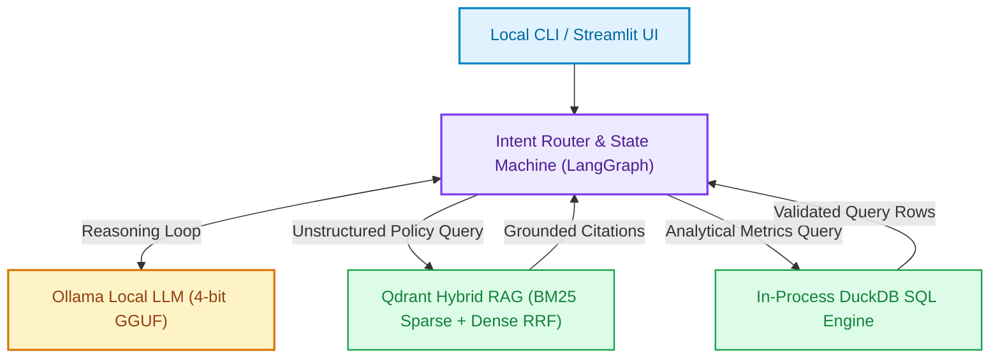
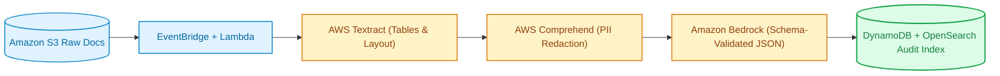
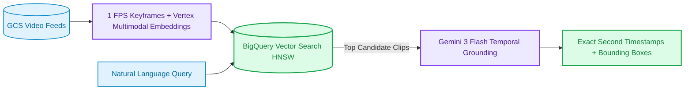
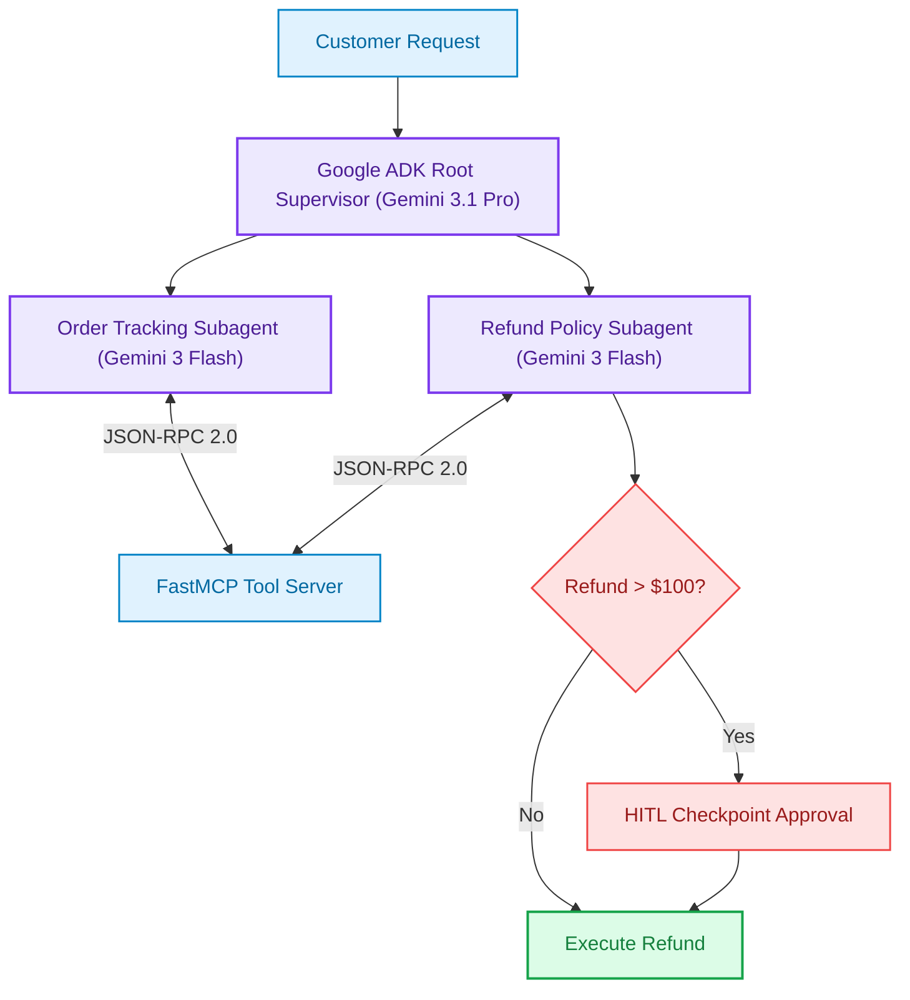

# Real-World AI/ML Portfolio Projects (Local & Cloud Blueprints + Starter Kits)

[← Back to Roadmap](../README.md) | [End-to-End Lifecycle Playbook →](./end_to_end_lifecycle_playbook.md) | [Starter 1: Local RAG + SQL Agent →](./intermediate/starter-local-rag-agent/README.md) | [Starter 2: Local MLOps →](./intermediate/starter-local-mlops/README.md)

---

A generic "PDF Chatbot" or "Iris classification script" will **not** get you hired. Hiring managers look for projects that demonstrate **system thinking**, handle **real-world edge cases (latency SLAs, token budgets, drift, class imbalance)**, and prove you can build **both locally on consumer hardware and at scale in the cloud**.

This curated collection is divided into two tracks: plus **2 runnable starter kits** right inside this folder so you never start from a blank directory:

1. **100% Local Projects (\$0 Cloud Cost):** Build entirely on your laptop/workstation using open-weight models, embedded vector/OLAP stores, and open-source MLOps tools without needing cloud credit cards.
2. **Cloud & Big Tech Enterprise Projects:** Mirror the production architectures built by **Google Cloud (GCP), AWS, Meta, and Stripe** engineering teams.

---

# Track 1: 100% Local Projects (\$0 Cloud Cost)
*Build and run everything locally on your Windows, macOS, or Linux laptop. Zero cloud API keys required.*

---

## Local Project 1: Private Air-Gapped Desktop RAG & Multi-Tool Agent
> **Key Skills:** Ollama, Qwen 3.5 / Gemma 3 / Llama 4, Qdrant (Embedded Hybrid Search), DuckDB (SQL), LangGraph  
> **Hardware:** Any 8GB-16GB RAM laptop or Apple Silicon / RTX GPU (\$0 API Cost)  
> **Runnable Starter Code:** **[Open `starter-local-rag-agent/` →](./intermediate/starter-local-rag-agent/README.md)**

### The Problem
Law firms, healthcare clinics, and defense researchers face strict privacy regulations (HIPAA/GDPR). They cannot upload confidential documents or tabular records to public cloud APIs. They need an **offline, air-gapped AI copilot** running locally on consumer hardware.

### Local Architecture & Workflow

1. **Local Model Runtime:** Run **Ollama** serving 4-bit quantized open-weight models (`qwen3:8b` or `gemma3:4b`) under 5 GB RAM.
2. **Embedded Hybrid Vector Database (`Qdrant`):** Use **`QdrantClient(path="./qdrant_local")`** to store both dense semantic embeddings and sparse `BM25` vectors on local disk with payload metadata filters and server-side **Reciprocal Rank Fusion (`RRF`)**.
3. **Embedded OLAP SQL Engine:** Query local CSV/Parquet files in milliseconds via in-process **DuckDB** with read-only SQL guardrails.
4. **Orchestration:** Route unstructured policy questions to Hybrid RAG and quantitative questions to DuckDB SQL.

### Interview Talking Points
- **Zero Data Exfiltration:** 100% air-gapped execution without external network calls.
- **4-bit Quantization Trade-offs:** Fitting 7B parameter models in `<5 GB` RAM with minimal `RAGAS` faithfulness loss.

---

## Local Project 2: Real-Time Edge Computer Vision & Multi-Object Tracking Pipeline
> **Key Skills:** YOLO26 (NMS-Free), ONNX Runtime, OpenCV, ByteTrack, FastAPI, Multi-threading  
> **Hardware:** Any laptop with a webcam or RTSP video file (\$0 Cloud Cost)

### The Problem
Retail stores and warehouses need live footfall counting, queue dwell-time analytics, and safety zone alerts. Streaming raw 1080p video feeds to the cloud wastes bandwidth and violates latency budgets: inference must run **on-premise at the edge**.

### Local Architecture & Workflow

1. **Decoupled Frame Ingestion:** Producer-consumer threads prevent RTSP buffer lag during inference spikes.
2. **ONNX Edge Acceleration:** Export `YOLO26n` (native NMS-free architecture) to **ONNX Runtime** (`INT8`/`FP16`) for 45-60+ FPS on consumer hardware.
3. **Multi-Object Tracking (`ByteTrack`):** Persist unique object IDs across occlusions using Kalman filter motion priors + IoU association.

---

## Local Project 3: Autograd Engine & Character-Level Transformer from Scratch
> **Key Skills:** Pure Python, NumPy, Reverse-Mode Autodiff, Scaled Dot-Product Attention, `AdamW`  
> **Hardware:** Any laptop CPU (\$0 Cloud Cost) | **Companion Lab:** [Open Attention Notebook](../notebooks/deep-learning/03_mini_transformer_attention.ipynb)

### Implementation Architecture
1. **Micro-Autograd Engine:** Scalar/tensor `Value` DAG node tracking `.data`, `.grad`, and topological `.backward()` chain-rule propagation.
2. **Decoder-Only Mini-Transformer:** Causal Multi-Head Self-Attention ($\text{softmax}(QK^\top/\sqrt{d_k} + M)V$), `LayerNorm`, residual highways, and numerically stable Cross-Entropy trained on TinyShakespeare.

---

## Local Project 4: Full-Lifecycle Local MLOps Pipeline with MLflow, Optuna & Docker
> **Key Skills:** Scikit-Learn / XGBoost, Optuna, MLflow, FastAPI, Non-Root Docker, PSI Drift, Pytest  
> **Hardware:** Any laptop (\$0 Cloud Cost)  
> **Runnable Starter Code:** **[Open `starter-local-mlops/` →](./intermediate/starter-local-mlops/README.md)**

### Implementation Architecture
1. **Leak-Free Training Pipeline:** `ColumnTransformer` + `GradientBoostingClassifier` tuned via Bayesian search, logging `PR-AUC`, `F1`, and artifacts.
2. **Production Serving (`FastAPI`):** Startup `lifespan` model loading, strict `Pydantic` validation, `/health` + `/predict` + `/drift-check` (`PSI`) endpoints.
3. **Containerization & Automated Tests:** Non-root `python:3.12-slim` `Dockerfile` verified by `pytest` `TestClient` assertions.

---

# Track 2: Cloud & Big Tech Enterprise Projects
*Production-scale reference architectures mirroring AWS, Google Cloud (GCP), Meta, and Stripe.*

---

## Project 5 (AWS Enterprise): Serverless Intelligent Document Processing (IDP) Pipeline
> **Target Roles:** AI Engineer, Cloud ML Engineer (AWS)  
> **Key Cloud Stack:** Amazon Bedrock, AWS Textract, AWS Comprehend (PII), OpenSearch Serverless, Lambda, EventBridge, DynamoDB

- **Key Talking Points:** Scale-to-zero event-driven ingestion, layout-aware table extraction via Textract, HIPAA/GDPR PII masking *before* LLM context ingestion, and strict Pydantic/JSON schema validation.

---

## Project 6 (GCP Enterprise): Multimodal Video Intelligence & Semantic Search Engine
> **Target Roles:** Multimodal ML Engineer, Computer Vision Engineer (GCP)  
> **Key Cloud Stack:** Vertex AI Multimodal Embeddings, Gemini 3 Flash, BigQuery Vector Search (`HNSW`), Cloud Storage, Cloud Run

- **Key Talking Points:** Joint video-audio-text 1408-dim vector alignment, zero-ETL petabyte ANN search directly inside BigQuery, and second-level temporal verification with Gemini 3 Flash.

---

## Project 7 (Google Ecosystem): Autonomous Operations Copilot with Google ADK & MCP
> **Target Roles:** AI Agent Engineer, Full-Stack AI Engineer  
> **Key Cloud Stack:** Google ADK (`google-adk`), Gemini 3.1 Pro / Gemini 3 Flash, FastMCP (`Streamable HTTP`), Cloud Run

- **Key Talking Points:** Subagent context isolation, model cascading (`Pro` supervisor + `Flash` workers), decoupled `FastMCP` backend tools, visual debugging via `adk web`, and durable `HITL` gates.

---

## Project 8 (Meta & Amazon): Two-Stage E-Commerce Recommendation & Ranking Engine
> **Target Roles:** Applied Scientist, RecSys ML Engineer  
> **Key Stack:** PyTorch Two-Tower DNN, `FAISS HNSW`, `LightGBM LambdaMART`, Redis, FastAPI

- **Stage 1 Retrieval (`<10ms`):** Dual User/Item PyTorch encoders + `FAISS HNSW` retrieving `Top 300` (`Recall@300`).
- **Stage 2 Ranking (`~12ms`):** `LightGBM LambdaMART` scoring rich real-time cross-features (`NDCG@10`), followed by `MMR` merchant diversity post-filtering under a `30ms` p99 SLA.

---

## Project 9 (FinTech / Stripe): Real-Time Fraud Prevention with `Feast` & Drift CI/CD
> **Target Roles:** MLOps Engineer, Production ML Engineer  
> **Key Stack:** `Feast` (Offline Parquet/Snowflake + Online Redis), `XGBoost`, `Evidently AI` (`PSI`), `MLflow`, GitHub Actions

- **Key Talking Points:** Eliminating Training-Serving Skew via `Feast` point-in-time joins, optimizing `PR-AUC` + cost-matrix decision thresholds on `0.1%` fraud imbalance, and automated `PSI >= 0.25` canary retraining triggers.

---

## Project 10 (AI Infrastructure): High-Throughput LLM Serving with `vLLM` & Semantic Caching
> **Target Roles:** AI Infrastructure / LLM Platform Engineer  
> **Key Stack:** `vLLM` (`PagedAttention`), Redis Semantic Cache, Prefix Caching, `OpenTelemetry` + `Arize Phoenix`

- **Key Talking Points:** Serving `<15ms` Redis semantic cache hits ($\cos \ge 0.96$) at `\$0` GPU cost, 2x-4x higher concurrency via `PagedAttention` + continuous batching, and full `TTFT`/`TPOT` OpenTelemetry span observability.

---

## Portfolio Comparison Matrix

| Track | Project | Core Stack | Cloud Spend | Primary Differentiator |
|---|---|---|---|---|
| **Local** | **1. Air-Gapped RAG & SQL Copilot** ([Starter](./intermediate/starter-local-rag-agent/README.md)) | Ollama, Qdrant Hybrid, DuckDB | **\$0** | Offline privacy + Qdrant RRF + DuckDB SQL routing |
| **Local** | **2. Edge CV Multi-Object Tracker** | YOLO26, ONNX, ByteTrack, OpenCV | **\$0** | NMS-free 45+ FPS edge tracking & dwell analytics |
| **Local** | **3. Autograd & Mini-Transformer** | Pure Python, NumPy | **\$0** | First-principles mastery of backprop & causal attention |
| **Local** | **4. Full-Lifecycle Local MLOps** ([Starter](./intermediate/starter-local-mlops/README.md)) | Scikit-Learn, FastAPI, Docker, PSI | **\$0** | End-to-end API, non-root Docker, PSI drift & Pytest |
| **Cloud** | **5. Serverless AWS IDP Pipeline** | Bedrock, Textract, Comprehend | Pay-per-use | Layout table OCR + pre-LLM HIPAA/GDPR PII redaction |
| **Cloud** | **6. GCP Video Semantic Search** | Vertex Multimodal, BigQuery HNSW | Pay-per-use | Sub-100ms vector search over video + Gemini grounding |
| **Cloud** | **7. Google ADK + MCP Ops Copilot** | `google-adk`, FastMCP, Cloud Run | Pay-per-use | Hierarchical subagents + MCP tools + `HITL` gates |
| **Cloud** | **8. Two-Stage RecSys Engine** | PyTorch Two-Tower, FAISS, LightGBM | Compute | `<30ms` p99 ANN retrieval + `LambdaMART` `NDCG@10` |
| **Cloud** | **9. Real-Time Fraud + `Feast`** | Feast, XGBoost, Evidently, MLflow | Compute | Zero training-serving skew + `PSI` drift self-healing |
| **Cloud** | **10. `vLLM` Serving + Cache** | `vLLM`, Redis, OpenTelemetry | GPU | `PagedAttention` batching + `TTFT`/`TPOT` telemetry |

---

[← Back to Roadmap](../README.md) | [Resume CAR Bullet Guide →](../interview-kits/resume_and_flashcards.md)
