# End-to-End AI Product Lifecycle Playbook: Day-0 Idea to Live Flywheel

[← Back to Portfolio Projects](./README.md) | [Home](../README.md) | [Starter 1: RAG + SQL Agent →](./starter-local-rag-agent/README.md) | [Starter 2: Local MLOps →](./starter-local-mlops/README.md)

---

Individual chapters teach isolated components (`SQL`, `XGBoost`, `Qdrant`, `LangGraph`, `FastAPI`, `Docker`), whereas real engineering value comes from **wiring all 7 lifecycle stages into one self-improving loop** ([McKinsey *State of AI 2026*](https://www.mckinsey.com/capabilities/quantumblack/our-insights/the-state-of-ai)). Use this blueprint whenever you build a flagship portfolio system or lead a production AI launch.

```mermaid
flowchart LR
    S1["1. Day-0 Spec & Unit Economics"] --> S2["2. Golden Eval Set & Labeling"]
    S2 --> S3["3. Simplest Baseline"]
    S3 --> S4["4. Trace Error Taxonomy"]
    S4 --> S5["5. Qdrant Hybrid + Agent / LoRA"]
    S5 --> S6["6. FastAPI SSE + Docker + CI Gate"]
    S6 --> S7["7. OTel + PSI Drift + DPO Flywheel"]
    S7 -->|"Hard Negatives & Human Edits"| S2

    classDef early fill:#E0F2FE,stroke:#0284C7,stroke-width:1.5px,color:#0369A1;
    classDef mid fill:#EDE9FE,stroke:#7C3AED,stroke-width:1.5px,color:#4C1D95;
    classDef prod fill:#DCFCE7,stroke:#16A34A,stroke-width:2px,color:#15803D;

    class S1,S2,S3 early;
    class S4,S5 mid;
    class S6,S7 prod;
```

---

## Stage 1: Problem Framing, Latency SLA & Unit Economics (Day 0)
Before importing `torch` or `qdrant_client`, write a 1-page engineering spec locking down:
- **North Star Business KPI:** e.g., *Automated Tier-1 Ticket Resolution Rate* or *Net Fraud Dollars Prevented*.
- **Hard Guardrail Constraints:** `TTFT <= 700ms`, `p99 E2E <= 2.5s`, `Zero unauthorized cross-tenant reads`, and `Cost <= $0.008 / resolved ticket`.

## Stage 2: Data-Centric Curation & Day-1 Golden Evaluation Set
Real projects never begin with a clean Kaggle CSV:
1. **PII Redaction & Deduplication:** Strip SSNs/emails/cards on ingestion and deduplicate near-identical documents (`MinHash` / cosine dedup) so test splits never leak into retrieval or training.
2. **150-Row Golden Dataset:** Curate 100 routine + 50 adversarial/edge-case queries labeled by two domain reviewers (verifying **Cohen's $\kappa \ge 0.80$** inter-annotator agreement). Wire this dataset into `pytest` / CI **before** iterating on models.

## Stage 3: Ship the Simplest Leak-Free Baseline First
- **Tabular / Risk Track:** Chronological split -> `StandardScaler` + `LogisticRegression` / `TabPFN` / `LightGBM` calibrated with `CalibratedClassifierCV` + `SHAP` attributions ([Module 03](../curriculum/02-core-ml-and-dl/03_classical_ml_and_recsys.md)).
- **GenAI / Agent Track:** Deterministic workflow router + single-call `BM25` + Flash/8B LLM with grammar-constrained `Pydantic` JSON output ([Module 06](../curriculum/03-modern-ai-and-genai/06_llms_finetuning_and_rag.md)).

## Stage 4: Trace-Driven Error Analysis (Eval-Driven Development)
Inspect 50-100 failed baseline spans in `Arize Phoenix` / `LangSmith` (`OpenTelemetry`) and categorize failures quantitatively:
- *Missing SKU / Acronym?* -> Upgrade retrieval to **`Qdrant` Hybrid (`BM25` Sparse + Dense `HNSW` + `Fusion.RRF`)** + Contextual Retrieval headers.
- *Right doc at Rank 18, ignored by LLM?* -> Add **`Qwen3-Reranker` / `ModernBERT` / `Cohere Rerank 4` (`Top 40 -> Top 5`)** and optimize **Context Engineering** prefix ordering.
- *Consistent tone/DSL formatting gap or high frontier API spend?* -> Distill your frontier teacher's verified traces into an 8B **`QLoRA`** student served on **`vLLM`**.
- *Multi-step dynamic tool recovery required?* -> Introduce a bounded **`LangGraph` / `Google ADK`** loop (`max_steps = 6`) connected via **`MCP`** (tools) and **`A2A`** (peer agents) with durable **`HITL` checkpoints** on state mutations ([Modules 07-09](../curriculum/04-agentic-ai/09_multi_agent_and_mcp.md)).

## Stage 5: Full-Stack Streaming UX (`FastAPI` `SSE`), Non-Root `Docker` & CI Gate
1. **Streaming UX:** Expose `/chat/stream` via `FastAPI` `StreamingResponse` (`text/event-stream`), emitting `status` frames (`"Searching Qdrant..."`), incremental `token` frames, and a final `trace_id` + verified `citation_ids` payload ([Module 11](../curriculum/05-production-and-practice/11_mlops_cloud_and_finops.md)).
2. **Container & CI/CD Gate:** Package in a non-root `python:3.12-slim` `Dockerfile`; block GitHub Actions PR merges if `pytest` fails or Golden Set `RAGAS Faithfulness` / `PR-AUC` drops `>2%`.

## Stage 6: Progressive Rollout, Drift Tripwires & The Continuous Data Flywheel
1. **Safe Release:** Shadow Traffic -> `5%` Canary -> Online A/B Z-Test ([Module 02](../curriculum/01-foundations/02_math_and_statistics.md)).
2. **Runtime Protection:** Session token circuit breakers (`max_usd = $0.10`), Redis semantic cache, daily **`PSI >= 0.25`** drift checks, and Cloud Budget kill-switches.
3. **Data Flywheel:** Every user thumbs-down or human support edit tied to `trace_id` flows nightly into (a) your **Golden Regression Suite** and (b) **`DPO` preference pairs** (`chosen = human_edit`, `rejected = model_draft`): compounding system quality every week in production.

---

[← Back to Portfolio Projects](./README.md) | [Home](../README.md)
